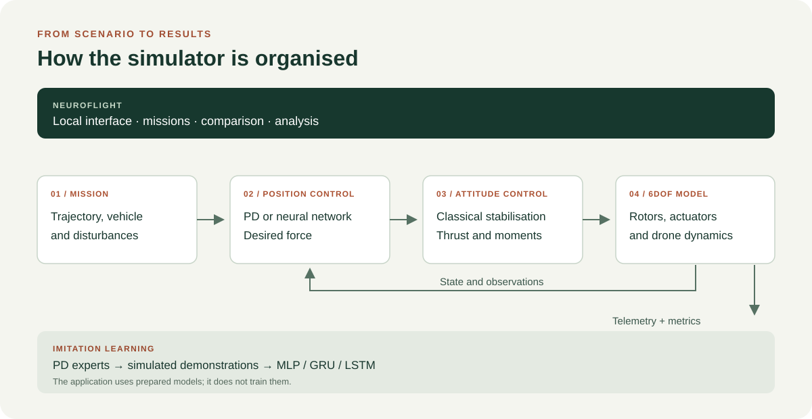
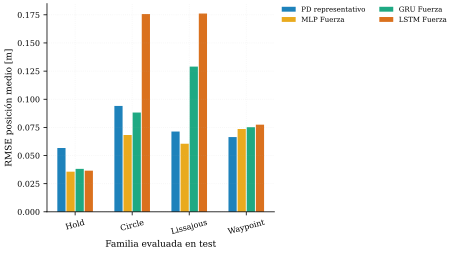
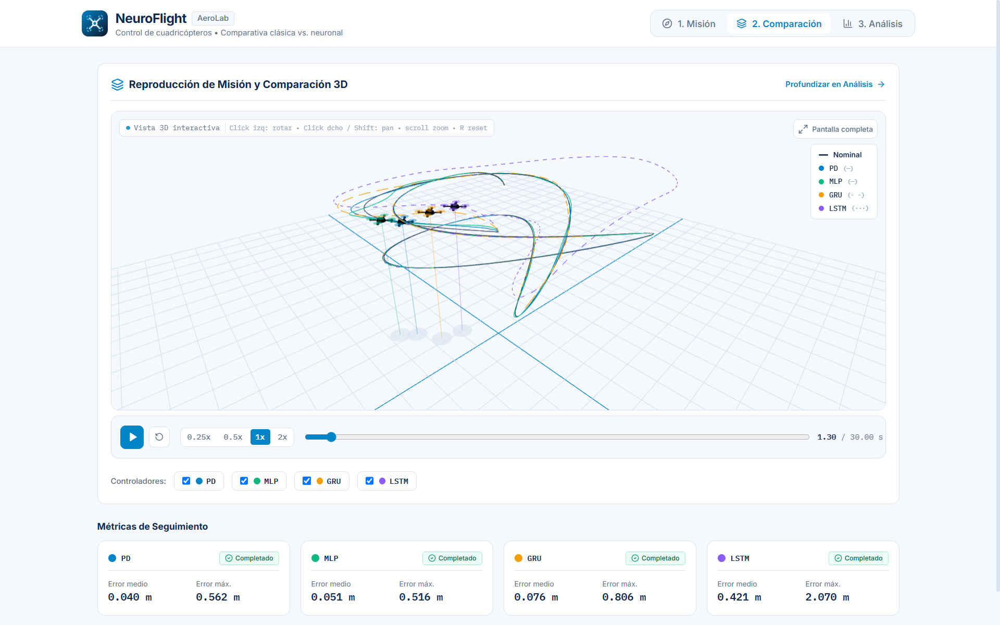

# 6DOF Quadcopter Simulator

[Español](README.md) | [English](README.en.md)

A reproducible 6DOF dynamics simulator for studying quadcopter trajectory tracking and comparing classical control with neural control trained through imitation learning. The project brings together the physical model, controllers, scenarios, experimental campaigns, and analysis tools in a single Python package.

Developed by Christian González Pérez as a Final Degree Project (TFG) at the University of León. [Visit the project website](https://christiangonper.github.io/modelado-control-dron-v2/en/).

## The question and the approach

Can a neural network replace several specialised position controllers while retaining trajectory-tracking performance? This final degree project builds a six-degree-of-freedom quadcopter simulator and compares controllers on reproducible trajectories and disturbances. A PD controller computes the desired force for position tracking; MLP, GRU and LSTM networks learn to imitate that force from simulated demonstrations. Attitude control and safety protections remain classical.



*Position control can be classical or neural; attitude control and the physical model are shared.*

## What the study found

On the in-distribution test set, GRU and LSTM imitated the expert force more closely, while MLP achieved lower tracking error on circles and Lissajous trajectories. In out-of-distribution scenarios, performance depended on the trajectory: GRU performed better than MLP on lemniscate and composite families, while MLP remained competitive on Lissajous and waypoint variants. Failures and degradation occurred; no architecture was universally best.

The study reports 23 test scenarios (184 runs) and 10 out-of-distribution scenarios (80 runs), each evaluated with four family PDs, three networks and a representative PD. These are **simulation results**, not flight tests. Aerodynamics, wind and sensors are simplified, and the sample and seeds are limited. The [English thesis PDF](site/assets/reports/TFG_Report_en.pdf) explains the protocol, results and limitations.

### A look at the results

The chart compares mean position error across the known test trajectory families. Performance changes with the trajectory; the [thesis](site/assets/reports/TFG_Report_en.pdf) also details the out-of-distribution evaluation and safety criteria.



*Aggregated TFG results: representative PD and MLP, GRU and LSTM networks. Lower error indicates better tracking under the evaluated conditions. Chart labels are in Spanish.*

## NeuroFlight: explore a mission

NeuroFlight is a local interactive application built around the simulator. It lets you:

1. **Design a mission**: choose a circle or combine several segments and preview the route in 3D.
2. **Compare controllers**: simulate the same mission with a PD and the MLP, GRU and LSTM networks, then replay their trajectories. The application selects the reference PD according to the mission.
3. **Inspect the outcome**: use tracking errors, safety information and telemetry to understand what happened during the simulated flight.



*A new demonstration mission: playback and tracking metrics for this example only.*

This is a screenshot of the real interface. New missions and the demo's regenerated models are distinct from the historical TFG results. NeuroFlight does not control a real drone or train networks from the interface.

**Try it locally:** the [NeuroFlight guide](docs/neuroflight.md) (Spanish) covers model preparation, installation and a first mission. The application is on the `concurso-prototipos-eiiia-2026` branch. The repository includes a bundle of regenerated models for trying it locally. The guide also describes the training route, which has not yet been validated end to end.

## Explore the code and the thesis

- [English thesis PDF](site/assets/reports/TFG_Report_en.pdf): methodology, experiments, findings and limitations.
- [Project website](https://christiangonper.github.io/modelado-control-dron-v2/en/): an introduction to the academic work.
- [TFG presentation](https://christiangonper.github.io/modelado-control-dron-v2/presentacion/): interactive defence slides in Spanish.
- [Simulator documentation](docs/simulador/README.md) (Spanish): installation, scenarios and technical tools.
- [NeuroFlight guide](docs/neuroflight.md) (Spanish): models, local setup and application walkthrough.

To run the simulator from a terminal, install Python 3.13 or later and [uv](https://docs.astral.sh/uv/). From the repository root:

```powershell
uv sync
uv run simulador-quad run scenarios\hover_clean.yaml --no-visualization
```

This creates new telemetry and metrics in `results/hover_clean/`; it is not an aggregate result from the thesis. The application additionally requires its models and a built frontend; follow its guide for setup.

## Project structure

```text
src/simulador_quad/  Physical model, controllers, simulation, and CLI
scenarios/           Reproducible YAML scenarios
tests/               Unit and integration tests
tools/               Datasets, tuning, training, and campaigns
docs/simulador/      Technical software documentation
data/                Locally generated datasets and models
results/             Generated telemetry, metrics, and plots
```

`data/` and most execution outputs are generated locally and are not part of the source code.

## Validation

Some tests require locally generated artefacts or the NeuroFlight bundle extracted into `data/neuroflight_bundle/`. A clean full test run in a fresh clone has not been established.

The test suite covers the physical model, frame conventions, controllers, configuration, metrics, and primary execution workflows:

```powershell
uv run pytest
```

Experimental comparisons distinguish between completing a mission (`mission_success`) and terminating without a physical failure (`safety_success`). Reaching the time limit on a finite trajectory does not count as mission completion.

## Contact

Christian González Pérez

- [christian.gonzalez.perez@pm.me](mailto:christian.gonzalez.perez@pm.me)
- [LinkedIn](https://www.linkedin.com/in/christiangonzalezperez/)
