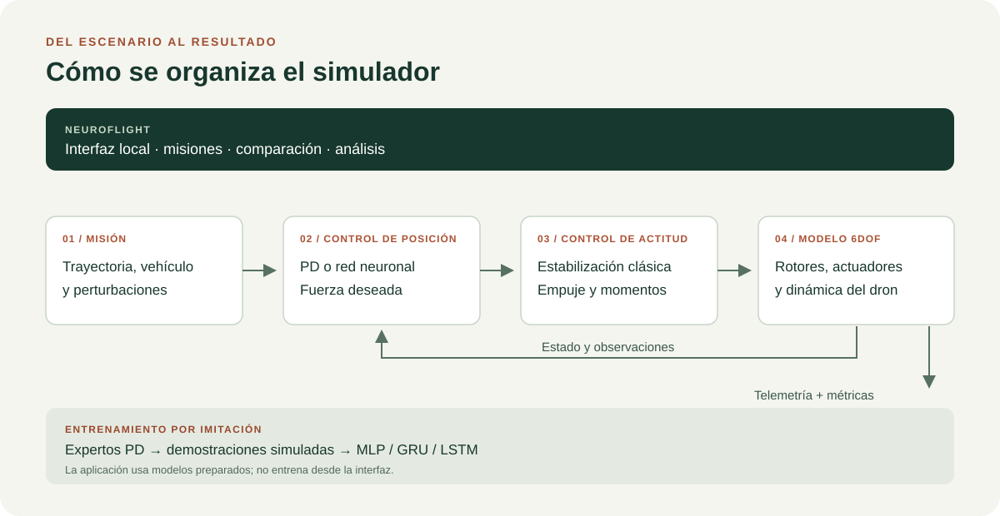
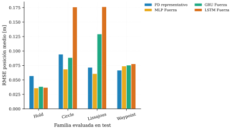
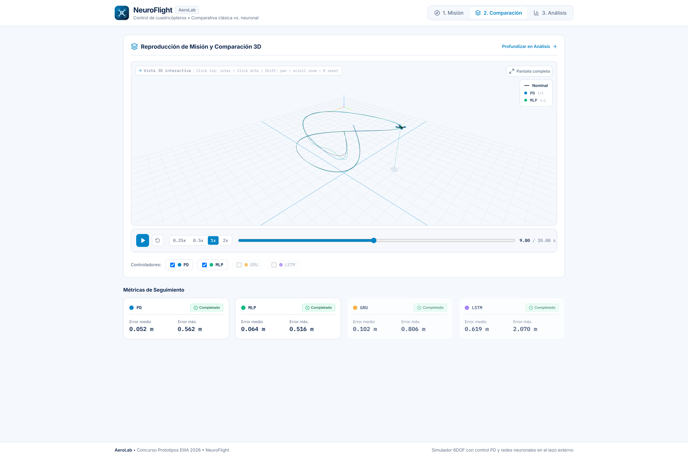

# Simulador 6DOF de cuadricóptero

[Español](README.md) | [English](README.en.md)

Simulador reproducible de dinámica 6DOF para estudiar el seguimiento de trayectorias de un cuadricóptero y comparar control clásico con control neuronal entrenado por imitación. El proyecto reúne el modelo físico, los controladores, los escenarios, las campañas experimentales y las herramientas de análisis en un único paquete de Python.

Desarrollado por Christian González Pérez como Trabajo de Fin de Grado (TFG) en la Universidad de León. [Visitar la página del proyecto](https://christiangonper.github.io/modelado-control-dron-v2/).

## La pregunta y el método

¿Puede una red neuronal sustituir varios controladores de posición especializados sin perder capacidad de seguimiento? El TFG construye un simulador de cuadricóptero de seis grados de libertad y compara controladores bajo trayectorias y perturbaciones reproducibles. Un PD calcula la fuerza deseada para seguir la referencia; MLP, GRU y LSTM aprenden a imitar esa fuerza a partir de demostraciones simuladas. El control de actitud y las protecciones siguen siendo clásicos.



*El control de posición puede ser clásico o neuronal; el control de actitud y el modelo físico son comunes.*

## Qué se observó en el TFG

En el conjunto de prueba conocido, GRU y LSTM imitaron mejor la fuerza del experto, pero MLP obtuvo menor error de seguimiento en círculo y Lissajous. En escenarios fuera de distribución, la respuesta dependió de la trayectoria: GRU obtuvo mejor resultado que MLP en las familias de lemniscata y composición, mientras que MLP siguió siendo competitivo en variantes de Lissajous y waypoint; aparecieron fallos y degradación. No se demuestra una superioridad general de una arquitectura. La memoria recoge 23 escenarios de prueba y 10 fuera de distribución, con 184 y 80 ejecuciones en total, respectivamente. En cada escenario se evaluaron ocho controladores: cuatro PD de familia, tres redes y un PD representativo. Véanse [resultados](TFG_Memoria/sections/07_resultados.tex) y [conclusiones y límites](TFG_Memoria/sections/09_conclusiones.tex).

Son resultados **de simulación**, no pruebas de vuelo real. El modelo simplifica aerodinámica, viento y sensores; la muestra y las semillas son limitadas y no hay intervalos de confianza. La imitación puede heredar sesgos de los expertos. La [memoria completa en PDF](site/assets/reports/TFG_Memoria_es.pdf) explica el protocolo y sus límites; la [web académica](https://christiangonper.github.io/modelado-control-dron-v2/) ofrece una presentación del trabajo.

### Una mirada a los resultados

La gráfica compara el error medio de posición por familia en las trayectorias conocidas de prueba. Muestra que el comportamiento cambia según la trayectoria; la [memoria](site/assets/reports/TFG_Memoria_es.pdf) detalla también la evaluación fuera de distribución y los criterios de seguridad.



*Resultados agregados del TFG: PD representativo y redes MLP, GRU y LSTM. Un error menor indica mejor seguimiento en las condiciones evaluadas.*

## NeuroFlight: del experimento a una aplicación interactiva

NeuroFlight lleva el simulador a una interfaz local para explorar cómo responde el cuadricóptero a distintas misiones. En una misma sesión puedes:

1. **Diseñar una misión**: elegir, por ejemplo, un círculo o encadenar varios tramos y comprobar la ruta prevista en 3D.
2. **Comparar controladores**: ejecutar la misma misión con un PD y las redes MLP, GRU y LSTM, y reproducir sus trayectorias. La aplicación elige el PD de referencia según la misión.
3. **Examinar los resultados**: consultar errores, protecciones y telemetría para entender qué ocurrió durante el vuelo simulado.



*Una misión nueva: reproducción y métricas de seguimiento. Los resultados corresponden únicamente a este ejemplo.*

La captura muestra la interfaz real. Cada misión de la aplicación es una simulación nueva: sus resultados y los modelos regenerados de la demo no son los resultados históricos del TFG. NeuroFlight no controla un dron real ni reentrena las redes desde la interfaz.

**¿Quieres probarlo?** La [guía de NeuroFlight](docs/neuroflight.md) explica cómo preparar los modelos, instalar la aplicación y recorrer una primera misión. La aplicación está en la rama `concurso-prototipos-eiiia-2026`; el repositorio incluye un paquete de modelos regenerados para probarla. La guía también describe la ruta de entrenamiento, todavía sin validar de principio a fin.

## Explorar el código y la memoria

- [Memoria del TFG en PDF](site/assets/reports/TFG_Memoria_es.pdf): metodología, experimentos, resultados y límites.
- [Web del proyecto](https://christiangonper.github.io/modelado-control-dron-v2/): presentación del trabajo académico.
- [Presentación del TFG](https://christiangonper.github.io/modelado-control-dron-v2/presentacion/): diapositivas interactivas de la defensa.
- [Documentación del simulador](docs/simulador/README.md): instalación, escenarios, controladores y herramientas técnicas.
- [Guía de NeuroFlight](docs/neuroflight.md): modelos, ejecución local y uso de la aplicación.

Si quieres ejecutar el simulador desde la terminal, instala Python 3.13 o posterior y [uv](https://docs.astral.sh/uv/). Desde la raíz del repositorio:

```powershell
uv sync
uv run simulador-quad run scenarios\hover_clean.yaml --no-visualization
```

Se generarán telemetría y métricas en `results/hover_clean/`. Es una ejecución nueva, distinta de los resultados agregados de la memoria. La aplicación requiere además los modelos y el cliente compilado; sigue su guía para prepararlos.

## Estructura del proyecto

```text
src/simulador_quad/  Modelo físico, controladores, simulación y CLI
scenarios/           Escenarios YAML reproducibles
tests/               Pruebas unitarias y de integración
tools/               Datasets, ajuste, entrenamiento y campañas
docs/simulador/      Documentación técnica del software
data/                Datasets y modelos generados localmente
results/             Telemetría, métricas y figuras generadas
```

`data/` y la mayor parte de las salidas de ejecución se generan localmente y no forman parte del código fuente.

## Validación

La batería de pruebas está diseñada para cubrir el modelo físico, las convenciones de marcos, los controladores, la configuración, las métricas y los principales flujos de ejecución:

```powershell
uv run pytest
```

Algunas pruebas requieren artefactos generados localmente o el paquete de NeuroFlight extraído en `data/neuroflight_bundle/`. La batería completa no se ha demostrado limpia en un clon nuevo.

La comparación experimental distingue entre completar una misión (`mission_success`) y terminar sin fallo físico (`safety_success`). Alcanzar el límite temporal en una trayectoria finita no se considera una misión completada.

## Contacto

Christian González Pérez

- [christian.gonzalez.perez@pm.me](mailto:christian.gonzalez.perez@pm.me)
- [LinkedIn](https://www.linkedin.com/in/christiangonzalezperez/)
