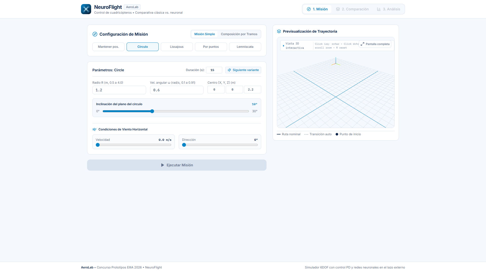
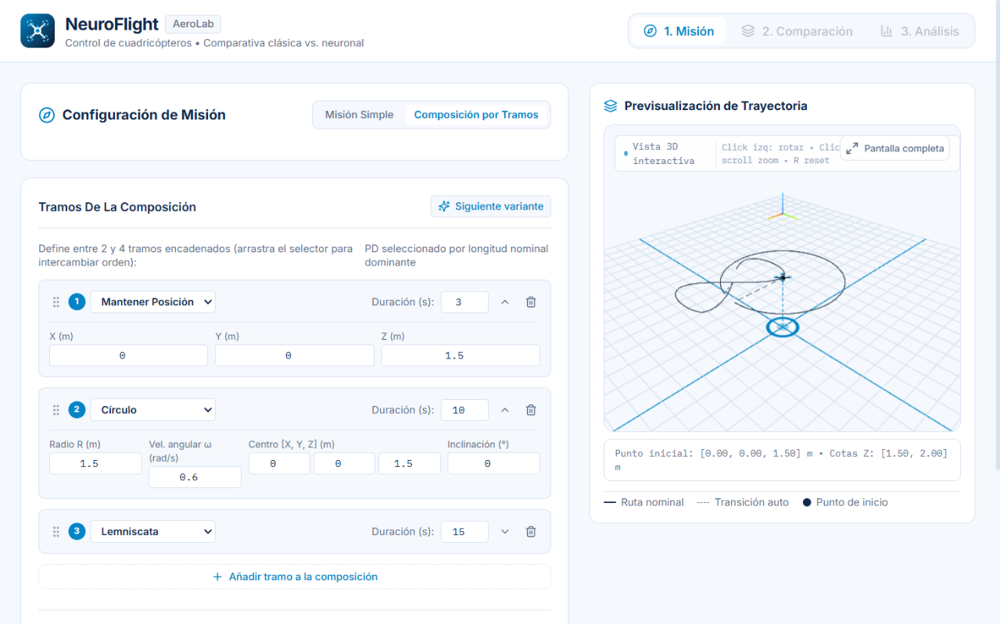
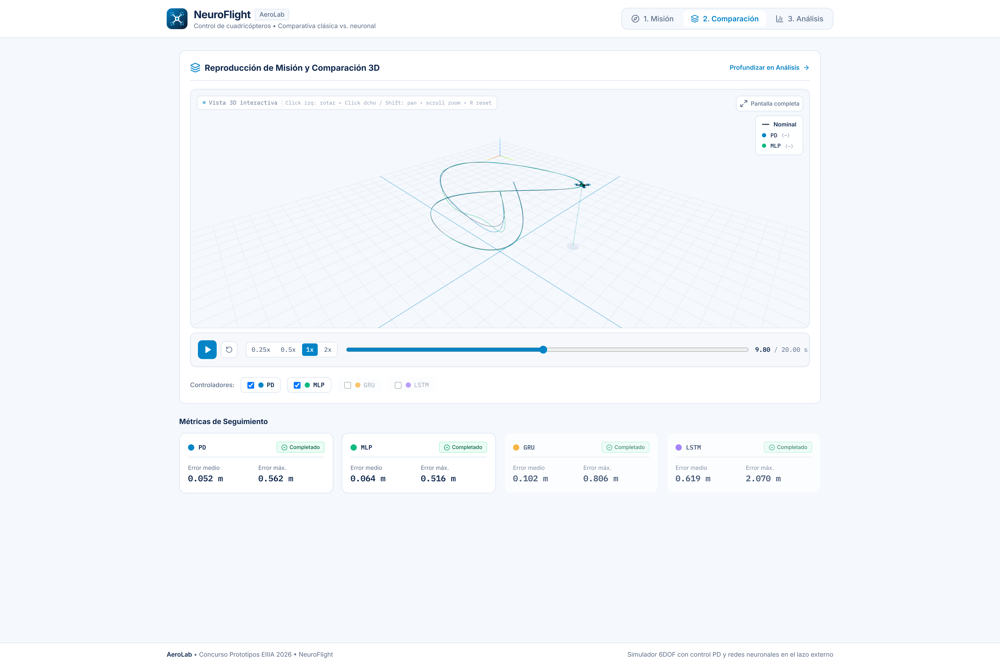

# NeuroFlight: guía de uso local

NeuroFlight es una aplicación que permite experimentar con el simulador del TFG desde el navegador. Puedes diseñar una trayectoria, compararla con un controlador PD y tres redes neuronales, reproducir los vuelos y examinar métricas y señales. Todo se ejecuta en tu ordenador: no controla un dron real y no entrena redes desde la interfaz.

Esta guía separa tres recorridos: [preparar los modelos](#1-preparar-los-modelos), [instalar y arrancar la aplicación](#2-instalar-y-arrancar-neuroflight) y [explorar una misión](#3-recorrer-una-misión). Al final se describe la [ruta de entrenamiento](#entrenar-los-modelos-desde-cero).

## 1. Preparar los modelos

El repositorio incluye un [paquete de modelos para la demostración](neuroflight-assets/modelos-neuroflight.zip). Contiene cuatro controladores PD y tres redes de fuerza exterior regenerados el 23 de septiembre de 2026. Son modelos nuevos, no los pesos históricos de la memoria. Sus datos de entrenamiento proceden de simulaciones y demostraciones de expertos PD, no de vuelos reales.

Después de clonar el repositorio, descomprime el archivo desde la raíz del proyecto. En PowerShell:

```powershell
Expand-Archive -LiteralPath docs\neuroflight-assets\modelos-neuroflight.zip -DestinationPath data\neuroflight_bundle
```

El destino debe contener directamente `bundle_manifest.json`, `pids/` y `neural_control/`. Si ya existe un paquete en esa carpeta, consérvalo o utiliza otra copia del proyecto antes de descomprimir. El manifiesto permite comprobar la integridad de los archivos al arrancar. Las misiones nuevas no son resultados agregados del TFG; consulta la [memoria](../site/assets/reports/TFG_Memoria_es.pdf) para el protocolo académico.

También puedes [entrenar modelos desde cero](#entrenar-los-modelos-desde-cero). Esa ruta requiere muchos más recursos y no se ha validado de principio a fin desde un clon limpio.

## 2. Instalar y arrancar NeuroFlight

Necesitas Git, Python 3.13 o posterior, [uv](https://docs.astral.sh/uv/) y Node.js con npm. La aplicación está en la rama `concurso-prototipos-eiiia-2026`. En PowerShell:

```powershell
git clone --branch concurso-prototipos-eiiia-2026 https://github.com/ChristianGonper/modelado-control-dron-v2.git
cd modelado-control-dron-v2
uv sync
cd frontend
npm ci
npm run build
cd ..
```

Prepara el paquete como se indica en el apartado anterior y arranca el servidor desde la raíz del repositorio:

```powershell
uv run neuroflight
```

Abre <http://127.0.0.1:8000>. Mantén la terminal abierta mientras uses la aplicación; para detenerla, pulsa Ctrl+C. Si la interfaz no aparece, comprueba que `frontend/dist/` existe y vuelve a compilarla. Si no puedes simular, revisa <http://127.0.0.1:8000/api/health>: informa si faltan archivos o si sus hashes no coinciden.

## 3. Recorrer una misión

### Diseñar la trayectoria

En **Misión**, selecciona «Mantener pos.» para una primera prueba y revisa la posición y la duración. La vista 3D muestra la trayectoria prevista antes de ejecutar. También puedes elegir un círculo, Lissajous, una ruta por puntos o una lemniscata, ajustar sus parámetros y añadir viento horizontal.



Para un recorrido más variado, elige **Composición por tramos**. Puedes encadenar entre dos y cuatro segmentos, cambiar su orden y modificar sus parámetros. La vista previa muestra tanto la ruta nominal como las transiciones automáticas. El PD de referencia se selecciona según la longitud nominal dominante.



### Ejecutar y comparar

Pulsa **Ejecutar Misión** y espera a que termine el cálculo. En **Comparación** revisa el estado de cada método antes de interpretar el vuelo: el PD, MLP, GRU y LSTM pueden no completar la misión en las mismas condiciones. Usa los controles del reproductor y selecciona las trayectorias que quieras observar. Una ejecución interrumpida solo aporta información hasta el instante de parada.



*Captura de una ejecución de demostración: se muestran la referencia y las trayectorias PD y MLP. Las métricas corresponden a esa misión, no al conjunto del TFG.*

### Analizar

En **Análisis** examina los errores de seguimiento, las protecciones y la telemetría disponible. Al comparar cifras, comprueba qué controladores completaron la trayectoria y durante cuánto tiempo se midió cada uno. Una diferencia en una misión concreta no demuestra que una arquitectura sea mejor en general: para eso consulta el conjunto de experimentos de la memoria.

Las ejecuciones nuevas se guardan en `data/neuroflight_runs/`, junto con su configuración y los hashes del paquete. No modifican los resultados históricos del TFG.

## Entrenar los modelos desde cero

Este recorrido explica cómo generar modelos nuevos de la misma familia que utiliza NeuroFlight. Requiere una GPU NVIDIA compatible con CUDA para el entrenamiento y puede necesitar mucho tiempo y espacio. Las simulaciones y el ajuste de los controladores clásicos utilizan CPU. No hemos ejecutado toda esta cadena desde un clon limpio: los comandos siguen la memoria y los scripts actuales, pero no podemos garantizar todavía una reproducción completa. Entrenar de nuevo tampoco recupera los pesos históricos ni garantiza las mismas cifras.

### Qué red se entrena

En el TFG, las redes MLP, GRU y LSTM evaluadas para el control de posición aprenden a predecir la **fuerza del lazo externo** a partir de ejemplos de controladores PD. El nombre técnico de esa variante en el código es `outer_force_min_v1`. NeuroFlight carga estas tres arquitecturas y cuatro PD de referencia. Consulta el [anejo de comandos de la memoria](../TFG_Memoria/appendices/a_comandos.tex) para el protocolo del TFG.

### 1. Preparar el entorno y comprobar la GPU

Trabaja en una copia separada y con un directorio `data/` nuevo: la generación y el ajuste escriben archivos y algunas opciones los sobrescriben. Instala las dependencias siguiendo la sección anterior. En PowerShell, desde la raíz, comprueba que PyTorch detecta CUDA:

```powershell
uv run python -c "import torch; print('CUDA disponible:', torch.cuda.is_available()); print('GPU:', torch.cuda.get_device_name(0) if torch.cuda.is_available() else 'no detectada')"
```

Si aparece `False`, resuelve primero la instalación compatible de PyTorch y los controladores de NVIDIA. En los comandos de entrenamiento y evaluación de redes, `--device cuda` exige una GPU disponible y no cambia silenciosamente a CPU. La generación de datos de las fases 2 a 5 utiliza CPU. Las dependencias del proyecto seleccionan su índice de PyTorch; consulta `pyproject.toml` si tu equipo necesita otra configuración.

### 2. Generar escenarios y ejemplos de expertos

Las fases 2 a 5 de la campaña preparan escenarios clásicos, ajustan y fijan los PD, ejecutan la base clásica y generan los ejemplos de fuerza. Primero puedes ver los comandos sin ejecutarlos:

```powershell
uv run python tools\run_experimental_campaign.py --phase 2-5 --workers 4 --dry-run
```

Para iniciar realmente la generación, retira `--dry-run`:

```powershell
uv run python tools\run_experimental_campaign.py --phase 2-5 --workers 4
```

Estas fases usan principalmente CPU. `--workers 4` limita los procesos paralelos; puedes ajustarlo a tu equipo. El resultado necesario para el entrenamiento es `data/outer_force_dataset/v1/`. Comprueba que la campaña termine sin errores antes de continuar.

### 3. Entrenar MLP, GRU y LSTM en GPU

El siguiente bucle sigue el comando del anejo para cada arquitectura y guarda cada modelo en una carpeta propia:

```powershell
foreach ($arquitectura in @('mlp', 'gru', 'lstm')) {
  uv run python tools\train_neural_controller.py --dataset data\outer_force_dataset\v1 `
    --architecture $arquitectura --feature-version outer_force_min_v1 `
    --out "data\neural_control\outer_force_${arquitectura}_min_v1" --device cuda
  if ($LASTEXITCODE -ne 0) { throw "Ha fallado el entrenamiento de $arquitectura" }
}
```

Cada salida incluye el mejor checkpoint, la configuración y la normalización; deben mantenerse juntos. Para evaluar la predicción supervisada, ejecuta para cada arquitectura:

```powershell
foreach ($arquitectura in @('mlp', 'gru', 'lstm')) {
  uv run python tools\evaluate_neural_controller.py --dataset data\outer_force_dataset\v1 `
    --run "data\neural_control\outer_force_${arquitectura}_min_v1" --device cuda
  if ($LASTEXITCODE -ne 0) { throw "Ha fallado la evaluación de $arquitectura" }
}
```

Esa evaluación por sí sola no reproduce la comparación completa del TFG: también se necesitan los experimentos de seguimiento en bucle cerrado, los escenarios fuera de distribución y su consolidación. El [anejo de la memoria](../TFG_Memoria/appendices/a_comandos.tex) recoge esos pasos.

### 4. Preparar el paquete para la aplicación

Si la generación ha producido los cuatro PD en `data/classic_dataset/v1/pids/` y los tres modelos con sus checkpoints, configuraciones y normalizaciones en las rutas anteriores, el empaquetador puede usar `data/` como raíz. Escribe en el destino: guarda antes cualquier paquete que quieras conservar.

```powershell
uv run python -c "from pathlib import Path; from tools.package_demo_artifacts import package_bundle; package_bundle(Path('data'), Path('data/neuroflight_bundle'))"
```

El empaquetado se ha comprobado con artefactos regenerados existentes, no con un entrenamiento nuevo completo. Tras crear el paquete, vuelve a [instalar y arrancar NeuroFlight](#2-instalar-y-arrancar-neuroflight) y revisa `/api/health`: `bundle.valid` debe ser `true`. El empaquetador predeterminado busca `data/regenerated_2026-09-23/`; el comando anterior indica expresamente la raíz alternativa `data/`.
