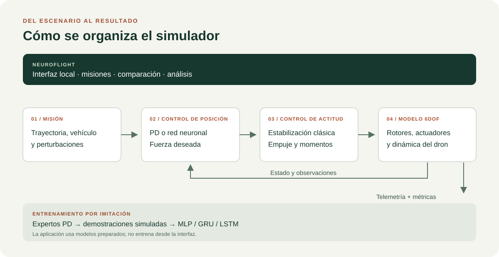

# Arquitectura del simulador

Esta página explica cómo se organiza el código y qué ocurre desde que se carga un escenario hasta que se guardan sus resultados. Los módulos agrupan el modelo físico, el control y las herramientas de análisis.

## Flujo de simulación

1. `app.py` recibe `simulador-quad run <escenario.yaml>`.
2. `scenarios.loader` lee y valida el YAML; despues instancia vehiculo, rotores, estado inicial, trayectoria, controlador, viento y ruido.
3. `SimulationRunner` inicializa tiempos de fisica, control y telemetria. Antes del primer paso fisico, el comando y los actuadores se inicializan en hover (`mass_kg * gravity_m_s2`) para evitar que un episodio nivelado empiece con los rotores a cero.
4. En cada ciclo:
   - obtiene la referencia de trayectoria para `time_s`; si la trayectoria implementa `get_reference_for_state`, tambien recibe el estado actual para generar referencias state-aware;
   - genera la observacion, con ruido si aplica;
   - llama al controlador cuando toca `control_dt_s`;
   - convierte empuje/momentos a comandos de rotor mediante el mezclador;
   - aplica retardo, lag y saturacion en actuadores;
   - guarda telemetria cuando toca `telemetry_dt_s`;
   - avanza el estado con RK4 usando `physics_dt_s`.
5. El episodio termina por límite de tiempo, por una condición de seguridad/validez o por haber llegado al final de una trayectoria finita (`line` / `waypoint`). En trayectorias state-aware, la terminación normal puede estar gobernada por `check_completion`.
6. Se exportan `telemetry.json` y `metrics.json`.
7. Se generan automáticamente figuras PNG y el visor interactivo `visualization_3d.html`.

## Modulos principales

- `core/contracts.py`: dataclasses de estado, parametros, referencias, comandos, rotores y telemetria.
- `core/attitude.py`: operaciones de cuaterniones y rotacion entre cuerpo y mundo.
- `core/frames.py`: actitud nivelada inicial ENU/FRD.
- `dynamics/rigid_body.py`: derivada 6DOF e integrador RK4.
- `dynamics/actuators.py`: retardo, lag, saturacion, empuje y par aplicado por rotores.
- `dynamics/mixer.py`: asignacion de empuje colectivo y momentos a empujes de rotor.
- `dynamics/perturbations.py`: drag lineal, viento constante y ruido de observacion.
- `scenarios/schema.py`: validacion fisica simple de YAML antes de simular.
- `trajectories/analytic.py`: referencias `hold`, `circle`, `lissajous` y `line` / `waypoint`. `line` y `waypoint` usan comportamiento `waypoint_stop`: perfil trapezoidal/triangular por tramo, parada en cada waypoint y avance condicionado por tolerancias y dwell.
- `trajectories/composite.py`: encadena subtrayectorias. Si se configura una velocidad de transición y la distancia entre tramos supera 5 cm, inserta una trayectoria lineal hacia el inicio del siguiente tramo.
- `control/classic.py`: controlador clasico en cascada; expone el calculo de fuerza externa y la conversion fuerza ENU a mando con lazo interno clasico.
- `control/neural.py`: `NeuralOuterForceController` para `type: neural`, que predice fuerza externa.
- `ml/`: carga de telemetria, normalizacion train-only, modelos MLP/GRU/LSTM, entrenamiento y evaluacion supervisada.
- `datasets/classic.py`: definicion reproducible del dataset clasico, familias, perfiles, YAML generados, PID iniciales, manifiesto y filtros de aceptacion.
- `runner.py`: orquestacion multi-rate, ZOH, telemetria y terminacion.
- `telemetry/export.py`: exportacion JSON.
- `metrics/report.py`: metricas agregadas con magnitudes fisicas separadas por unidades.
- `visualization/plots.py`: figuras por episodio a partir de `telemetry.json`.
- `visualization/comparison.py`: figuras comparativas C1–C7 desde `comparison_all_runs.csv`.
- `visualization/style.py`: paleta, estilos por controlador y perfiles `diagnostic`/`report`.
- `visualization/export.py`: exportación PNG/PDF a 300 dpi.
- `visualization/three_d.py`: visor interactivo HTML 3D basado en Plotly.
- `tools/generate_classic_dataset.py`: genera estructura `data/classic_dataset/<version>/` con `manifest.csv`, `pids/` y escenarios YAML.
- `tools/tune_classic_pid.py`: ajusta un PID clasico por familia en el perfil nominal con drag y actuadores.
- `tools/run_classic_dataset.py`: ejecuta episodios del manifiesto, opcionalmente en varios procesos, y escribe `run_report.csv`.
- `tools/summarize_classic_dataset.py`: resume resultados del dataset en `summary.csv`.
- `tools/generate_outer_force_pid_bank.py`: ejecuta variantes del PID externo por escenario fuente conservando la configuracion interna y los limites originales.
- `tools/generate_outer_force_dataset.py`: selecciona un experto seguro por escenario y produce telemetria/YAML coherentes para targets de fuerza.
- `tools/train_neural_controller.py`: entrena MLP, GRU o LSTM por imitacion de `desired_force_W_N` desde el dataset `outer_force`.
- `tools/evaluate_neural_controller.py`: evalua modelos entrenados sobre `train`/`val`/`test` y, opcionalmente, un dataset OOD.
- `tools/run_neural_scenario.py`: ejecuta un escenario existente sustituyendo el controlador por un checkpoint neuronal sin modificar el YAML base.
- `tools/generate_pid_bank.py`: crea un banco inicial de PIDs por familia a partir de los PIDs actuales.

## Contratos de datos

Los contratos relevantes para interpretar resultados son:

- `VehicleState`: estado verdadero u observacion del controlador.
- `TrajectoryReference`: referencia instantanea de posicion, velocidad, aceleracion y yaw.
- `ControlCommand`: empuje colectivo y momentos de cuerpo solicitados por el controlador.
- `RotorCommand`: empuje y `omega` objetivo por rotor, mas bandera de degradacion.
- `RotorAppliedState`: `omega`, RPM, empuje, par y saturacion realmente aplicados.
- `TelemetrySample`: muestra que agrupa estado, observacion, referencia, control y rotores.

La telemetria distingue comando solicitado, comando objetivo de rotor y estado aplicado. Esta separacion es importante para estudiar saturacion, retardos y lag de actuadores.

Las trayectorias analiticas (`hold`, `circle`, `lissajous`) dependen solo de `time_s`. Las trayectorias `line` / `waypoint` son state-aware: mantienen fase interna de mision y generan la referencia del siguiente waypoint usando el estado actual para comprobar asentamiento. El campo legacy `times` puede aparecer en YAML, pero no controla el avance entre waypoints. Las trayectorias compuestas (`composite`) combinan secuencialmente ambos tipos de trayectorias, realizando un seguimiento temporal de cada sub-trayectoria (usando el campo `duration` en las analíticas) y controlando la transición a la siguiente mediante la comprobación de completitud (`check_completion`).

## Telemetria

Cada muestra de `telemetry.json` contiene:

- `time_s`
- `state`
- `observation`
- `reference`
- `control`
- `rotors`
- `termination_cause`

`state` es el estado verdadero del simulador. `observation` es lo que vio el controlador; puede diferir por ruido. `reference` es la trayectoria deseada. `control` es la salida del controlador. `rotors` separa objetivo y aplicado.

## Validacion de escenarios

Antes de ejecutar o instanciar un escenario, `validate_scenario_config` comprueba los parametros fisicos que afectan directamente a la validez del resultado: masa, gravedad, inercia, drag, rotores, tiempos, limites opcionales de terminacion y estado inicial. Los errores incluyen la ruta del campo, por ejemplo `vehicle.rotors[0].omega_max_rad_s`.

Los limites de posicion y velocidad no son configurables desde YAML. `SimulationRunner` aplica sus constantes internas de `100.0 m` por componente y `50.0 m/s` por componente; el esquema rechaza `termination.max_position_m` y `termination.max_speed_m_s`.

Si `initial_state.orientation_WB` es `null`, el cargador genera una actitud nivelada a partir de `yaw_rad`. Si se proporciona un cuaternion, debe ser finito y unitario; la validacion lo rechaza en lugar de normalizarlo silenciosamente.

Para `trajectory.type: "line"` o `"waypoint"`, la validacion comprueba que `waypoints` sea una lista no vacia de puntos `[3]` finitos, que `times` tenga la misma longitud si aparece como campo deprecated, y que los parametros opcionales de velocidad, aceleracion, tolerancia y dwell sean no negativos o positivos segun corresponda.

Para `trajectory.type: "composite"`, la validación comprueba de forma recursiva que la secuencia de sub-trayectorias no esté vacía, que cada una sea válida de acuerdo a su tipo, que el campo `duration` sea obligatorio y positivo para las sub-trayectorias analíticas de la secuencia, y que si se define `duration` en cualquier sub-trayectoria, este sea estrictamente positivo. También valida que la velocidad de transición `transition_speed` sea positiva si se proporciona.

Para `controller.type: "classic"`, el YAML puede declarar `Kp_pos`, `Kd_pos`, `Kp_att`, `Kd_att` y `max_body_moments_Nm` como vectores de tres componentes no negativas. Si faltan ganancias, el controlador conserva sus defaults.

Para `controller.type: "neural"`, el YAML debe declarar `architecture`, `checkpoint_path`, `normalization_path`, una `feature_version` `outer_force_*` y `max_desired_tilt_rad`. La red predice `desired_force_W_N[3]` en mundo ENU; un controlador clasico interno la convierte en empuje colectivo y momentos FRD. Las arquitecturas soportadas son `mlp`, `gru` y `lstm`; GRU/LSTM mantienen ventana interna y el runner llama a `reset()` al inicio. Con `clip_to_classic_limits: true`, la fuerza se limita por norma a `mass_kg*gravity_m_s2*2.5`, por inclinacion deseada y por una componente vertical ascendente minima; despues el PID interno aplica `max_body_moments_Nm`. Se rechazan los checkpoints incompatibles con esta arquitectura.

La evaluacion supervisada de `neural` se hace sobre telemetria del dataset `outer_force`: `train` calcula normalizacion, `val` selecciona checkpoint y `test` mide imitacion in-distribution en unidades de fuerza. OOD se evalua aparte con `--ood-dataset`, que debe contener `manifest.csv` y telemetria previamente generada; el evaluador no ejecuta escenarios por si mismo.

## Dataset clasico

La capa `datasets/classic.py` define el dataset clasico versionado previo a la fase neuronal. No entrena redes ni carga tensores de ML: genera escenarios YAML reproducibles para ejecutar el controlador clasico.

La version `v1` contiene 150 episodios:

- `hold`: 18 episodios.
- `circle`: 48 episodios.
- `lissajous`: 48 episodios.
- `waypoint`: 36 episodios.

Cada familia usa un PID congelado identificado como `pid_<family>_<version>`. El perfil nominal de ajuste incluye drag lineal y dinamica de actuadores; no incluye viento ni ruido. Las variantes del dataset cambian geometria, viento, ruido, drag y actuadores sin reajustar el PID.

Los escenarios generados inicializan el estado desde la referencia de la trayectoria en `t = 0`: posicion y yaw coinciden con la referencia inicial, velocidad lineal y angular empiezan a cero y `orientation_WB` queda como `null` para que el cargador genere una actitud nivelada ENU/FRD. Asi el dataset mide seguimiento de trayectoria, no captura desde una posicion arbitrariamente alejada.

Artefactos generados:

- `manifest.csv`: indice de escenarios, familia, geometria, perturbacion, PID, semilla, split, YAML y directorio de resultado.
- `pids/*.yaml`: ganancias por familia. Si no existen, la generacion crea YAML iniciales con `source: default_initial`.
- `scenarios/<family>/*.yaml`: escenarios ejecutables por el runner normal.
- `results/<family>/<scenario_id>/`: salidas de simulacion.
- `run_report.csv`: estado de ejecucion por escenario.
- `summary.csv`: resumen de metricas y validez por filtros duros.

## Dataset de fuerza externa

El dataset `outer_force` deriva del manifiesto clasico, pero no reutiliza sus comandos como targets. Para cada escenario fuente, `generate_outer_force_pid_bank.py` ejecuta variantes de `Kp_pos` y `Kd_pos` bajo exactamente la trayectoria, perturbaciones, semilla, vehiculo, PID interno y limites del escenario. `generate_outer_force_dataset.py` descarta candidatos que no pasan filtros duros, elige el menor RMSE y, entre candidatos dentro del 5% del mejor, el de menor esfuerzo; un empate real se resuelve conservadoramente. La telemetria copiada y las ganancias del YAML final pertenecen al experto seleccionado para ese escenario.

## Metricas

`metrics.json` resume:

- error de posicion: RMSE, MAE, maximo y desviacion tipica;
- empuje colectivo solicitado por el controlador en N: media, maximo, minimo y desviacion tipica;
- norma de momentos de cuerpo solicitados en Nm: media, maximo y desviacion tipica;
- indice heuristico de esfuerzo `|T| + ||tau||`, conservado por compatibilidad y solo apto para diagnostico;
- maxima velocidad de rotor en `rad/s` y RPM;
- tiempo y porcentaje de saturacion;
- tiempo y porcentaje de degradacion de empuje colectivo;
- causa de terminacion y duracion;
- metadatos de reproducibilidad: escenario, semilla, controlador, comando, version del paquete, Python/plataforma, estado Git, hashes de escenario/`uv.lock`, configuracion original y configuracion efectiva con defaults.

Las metricas no sustituyen a la inspeccion de telemetria. Para explicar un resultado en la memoria, conviene combinar `metrics.json` con las figuras generadas automaticamente y el visor 3D interactivo. Las comparaciones fisicas deben apoyarse en campos con unidades explicitas; el indice heuristico no debe presentarse como esfuerzo fisico total porque suma N y Nm.

## Limites actuales

- El viento es constante.
- El ruido de observacion afecta solo a posicion y velocidad.
- La visualización es postproceso y automática tras cada ejecución exitosa.
- El controlador `neural` aprende por imitacion supervisada de fuerza externa solicitada por un PID experto seleccionado; no optimiza directamente una funcion de coste en bucle cerrado.
- La evaluacion `train`/`val`/`test` del dataset clasico mide desempeno in-distribution. La generalizacion debe evaluarse con datasets o escenarios OOD separados.
- Las metricas supervisadas de `neural` miden error de fuerza; los porcentajes de clipping y las metricas fisicas de trayectoria deben verificarse en ejecucion cerrada.
